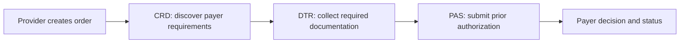

# Da Vinci PAS, CRD and DTR learning path

Baseline versions for this lab were checked on 2026-07-14: US Core 9.0.0, PAS 2.2.1, CRD 2.2.1 and DTR 2.2.0. All are FHIR R4 implementation guides and remain standards for trial use, so package versions must be pinned and rechecked before production work.

## How the workflow fits together

1. **CRD — Coverage Requirements Discovery:** an EHR workflow invokes payer decision support, commonly through CDS Hooks, to learn coverage, documentation and prior-authorization requirements while an order is being created.
2. **DTR — Documentation Templates and Rules:** the provider system retrieves and runs payer questionnaires/rules, then gathers the clinical documentation required for the request.
3. **PAS — Prior Authorization Support:** the provider submits the profiled FHIR prior-authorization request, centered on the PAS `Claim` `$submit` operation, and processes the payer response.

## Lab sequence

| Stage | Practical deliverable | Evidence |
|---|---|---|
| Foundation | Validate a synthetic Patient against `hl7.fhir.us.core#9.0.0`. | Validator output committed with the case-study notes. |
| CRD | Build a synthetic `order-sign` CDS Hooks request and a payer response card. | Positive and missing-context tests. |
| DTR | Add a synthetic Questionnaire/QuestionnaireResponse round trip. | Required-answer and invalid-code tests. |
| PAS | Build a PAS request Bundle from the lab's Patient, Coverage, Encounter and service request. | Validate against `hl7.fhir.us.davinci-pas#2.2.1`; do not equate the current DFT Claim with PAS conformance. |
| Security | Apply the Da Vinci HRex security/privacy expectations and SMART authorization scopes. | Token-required tests, audit logs and least-privilege cases. |

## Important distinction

The present DFT-to-Claim channel demonstrates revenue-cycle transformation, not Da Vinci PAS conformance. PAS requires additional profiled resources, identifiers, attachments, operation semantics, business rules and security requirements. The portfolio should claim familiarity and a staged implementation path until the PAS validator and workflow tests pass.

## Official references

- [US Core 9.0.0](https://www.hl7.org/fhir/us/core/)
- [Da Vinci PAS](https://hl7.org/fhir/us/davinci-pas/)
- [Da Vinci CRD](https://hl7.org/fhir/us/davinci-crd/)
- [Da Vinci DTR](https://hl7.org/fhir/us/davinci-dtr/)
- [Da Vinci HRex](https://hl7.org/fhir/us/davinci-hrex/)
