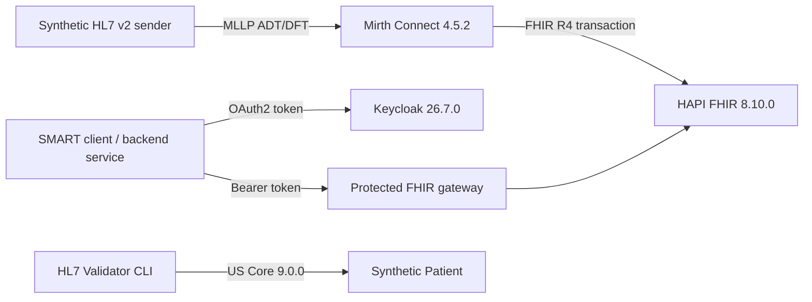

# Healthcare Interoperability Homelab: HL7 v2 to Secured FHIR R4

## Executive summary

I built a synthetic healthcare interoperability environment that receives HL7 v2 ADT and DFT messages through Mirth Connect, maps them to FHIR R4 resources in HAPI FHIR, validates a Patient against US Core 9.0.0, and protects a demonstration FHIR endpoint with Keycloak OAuth2/OIDC and SMART discovery metadata. Automated tests cover positive processing, malformed messages, negative acknowledgments and recovery.

The project connects my healthcare revenue-cycle and coding background with my MS in Management Information Systems, SQL/data skills and infrastructure experience. It is intentionally a homelab project and does not process PHI.

## Problem

Healthcare integration roles require more than knowledge of FHIR resource names. A credible implementation must receive legacy HL7 v2 traffic, preserve identifiers and references, express coded clinical and billing concepts correctly, reject bad input safely, validate profiles, secure access and document limitations.

## Architecture

The stack runs across a Proxmox homelab. Mirth and Keycloak use isolated PostgreSQL databases and durable Docker volumes. HAPI FHIR runs separately so integration-engine, identity and FHIR-server responsibilities remain visible.

## What I implemented

### HL7 v2 interfaces

- MLLP listeners for ADT on TCP 6661 and DFT on TCP 6662.
- Source filters, required-field checks, destination completion before positive acknowledgment and destination retry settings.
- Deterministic FHIR ids so message replay updates existing resources.

### FHIR transformations

- ADT to Patient and Encounter in one FHIR transaction.
- DFT to Coverage and Claim in one FHIR transaction.
- Patient/Encounter references preserved across clinical and billing flows.
- ICD-10-CM diagnosis and CPT service coding on Claim.
- Separate synthetic examples for SNOMED CT Condition, LOINC Observation and RxNorm MedicationRequest.

### Conformance and security

- HL7 Validator CLI package validation against `hl7.fhir.us.core#9.0.0`: 0 errors.
- A practical CRD/DTR/PAS learning path that distinguishes a DFT Claim from a PAS-conformant request.
- Keycloak OAuth2/OIDC, a public authorization-code/PKCE demo client, a backend service client, SMART discovery metadata and a protected FHIR gateway.

### Test engineering

- Positive ADT and DFT integration tests with FHIR assertions.
- Malformed ADT test expecting `AE` rather than false success.
- Recovery test proving a valid message succeeds after a failure.
- SMART test for discovery, unauthenticated denial, token issuance and protected CapabilityStatement access.

## Results

| Control | Result |
|---|---|
| ADT to Patient/Encounter | Passed with `AA` and verified FHIR resources. |
| DFT to Claim/Coverage | Passed with `AA`; verified CPT, ICD-10-CM and amount. |
| Malformed message | Rejected with `AE`. |
| Recovery after error | Next valid message accepted with `AA`. |
| US Core Patient | 0 errors; offline terminology warnings documented. |
| OAuth2/SMART gateway | Discovery, denial, token and protected access passed. |

## Engineering decisions

**Synthetic data only.** The project is safe to demonstrate and makes no claim of HIPAA production readiness.

**Idempotent writes.** Patient, Encounter, Coverage and Claim use deterministic logical ids with transaction `PUT`, limiting duplicates during replay.

**Truthful conformance language.** US Core was validated with the published package. Da Vinci PAS/CRD/DTR are documented as the next implementation phase; the current DFT Claim is not presented as PAS-conformant.

**Defense in depth remains unfinished.** The protected gateway demonstrates OAuth2 and SMART discovery over the lab network. Production would require TLS, private routing to the unprotected HAPI port, asymmetric SMART Backend Services authentication, fine-grained scope enforcement, centralized secrets and HA.

## Next iteration

1. Add TLS and expose HAPI only through the authenticated gateway.
2. Have Mirth request and refresh a backend token, then remove its direct HAPI route.
3. Implement a CRD CDS Hooks request, a DTR Questionnaire flow and a PAS `$submit` Bundle.
4. Add a terminology server for online value-set/code validation.
5. Add load tests, disaster-recovery timing and message-store replay exercises.

## Skills demonstrated

HL7 v2, MLLP, Mirth Connect, FHIR R4, HAPI FHIR, Patient, Encounter, Coverage, Claim, REST APIs, JSON, ICD-10-CM, CPT, LOINC, SNOMED CT, RxNorm, US Core, SMART on FHIR concepts, OAuth2/OIDC, Keycloak, PostgreSQL, Docker, Proxmox, Python integration testing, negative testing, recovery testing and technical documentation.
